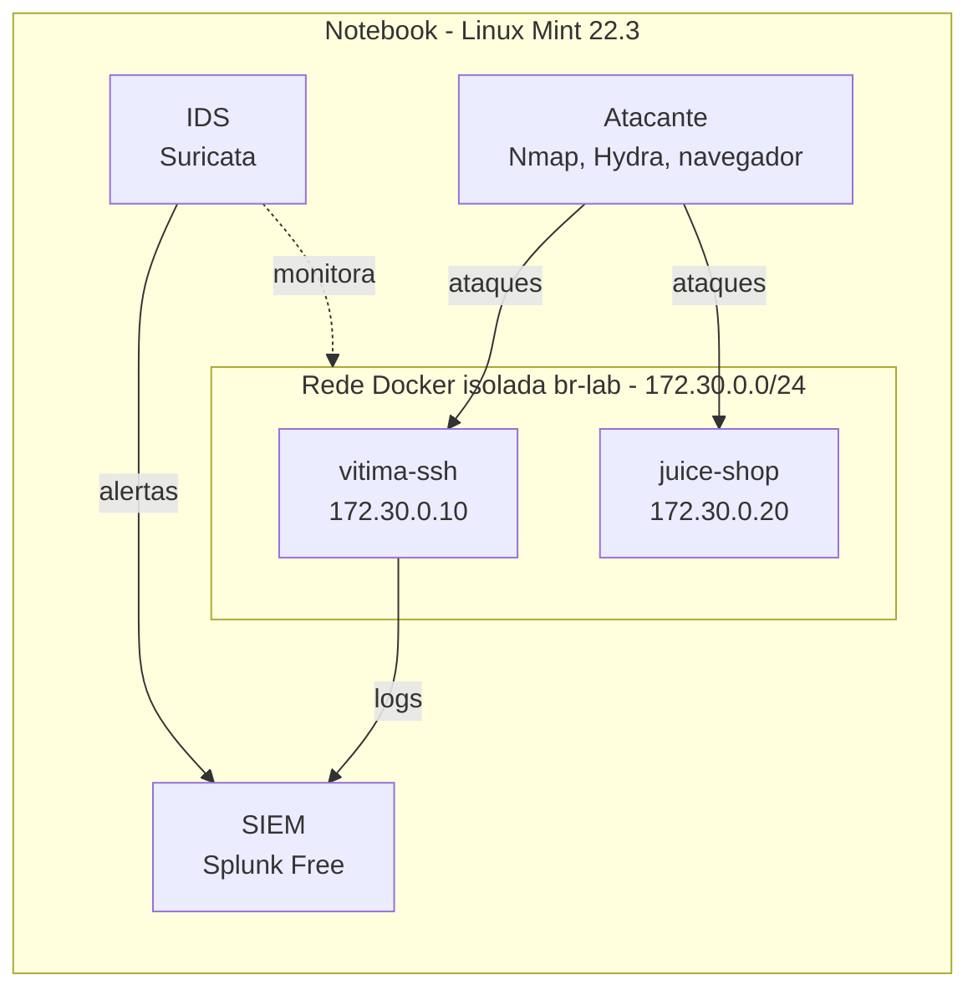

# 🛡️ SOC Home Lab

Laboratório doméstico de **Blue Team / SOC** montado em um notebook com **6 GB de RAM** e **Linux Mint 22.3**, para simular ataques, detectá-los com um SIEM e um IDS, e documentar cada investigação.

> 🚧 Em construção. Status atual: **Fase 2, SIEM.**

## Arquitetura

## O que este lab demonstra

- Montagem de ambiente isolado com **Docker** e decisões de hardening
- Coleta e investigação de logs em **SIEM (Splunk / SPL)**
- Detecção de ataques de rede com **IDS (Suricata)**
- Simulação de ataques e mapeamento no **MITRE ATT&CK**
- Escrita de **relatórios de incidente**

## Fases

| Fase | Conteúdo | Status |
|---|---|---|
| 1 | [Base: Docker, firewall e rede isolada](docs/01-base-docker-rede.md) | ✅ |
| 2 | [SIEM: Splunk Free](docs/02-splunk.md) | 🟡 |
| 3 | IDS: Suricata | ⬜ |
| 4 | Ataques, detecções e relatórios | ⬜ |

## Restrições e decisões principais

- **6 GB de RAM:** containers no lugar de máquinas virtuais; o lab só fica ligado durante o estudo.
- **Splunk Free em vez de Wazuh:** a implantação do Wazuh em Docker exige no mínimo 8 GB de RAM.
- **Nenhuma porta publicada:** os alvos vulneráveis ficam inacessíveis para o resto da rede.

## ⚖️ Aviso

Todas as ferramentas ofensivas foram usadas **exclusivamente contra os containers deste laboratório**.
