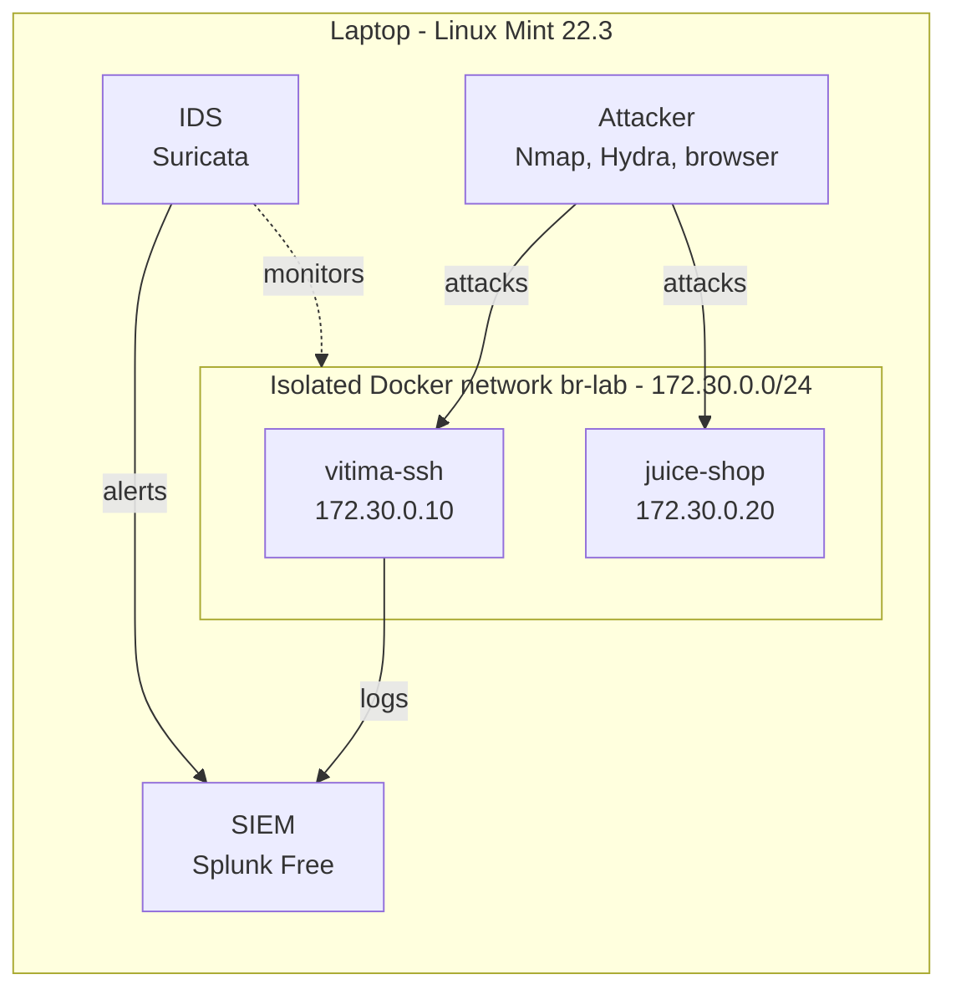

# SOC Home Lab

A **Blue Team / SOC** home lab built on a laptop with **6 GB of RAM** running **Linux Mint 22.3**, used to simulate attacks, detect them with a SIEM and an IDS, and document each investigation.

> Work in progress. Current stage: **Phase 2, SIEM.**

## Architecture

## What this lab demonstrates

- Building an isolated environment with **Docker**, including hardening decisions
- Log collection and investigation in a **SIEM (Splunk / SPL)**
- Network attack detection with an **IDS (Suricata)**
- Attack simulation mapped to **MITRE ATT&CK**
- Writing **incident reports**

## Phases

| Phase | Content | Status |
|---|---|---|
| 1 | [Base: Docker, firewall and isolated network](docs/01-base-docker-network.md) | Done |
| 2 | [SIEM: Splunk Free](docs/02-splunk.md) | In progress |
| 3 | IDS: Suricata | Planned |
| 4 | Attacks, detections and reports | Planned |

## Key constraints and decisions

- **6 GB of RAM:** containers instead of virtual machines; the lab only runs during study sessions.
- **Splunk Free instead of Wazuh:** the Wazuh Docker deployment requires at least 8 GB of RAM.
- **No published ports:** the intentionally vulnerable targets are unreachable from the rest of the network.

## Disclaimer

All offensive tools were used **exclusively against the containers in this lab**.
